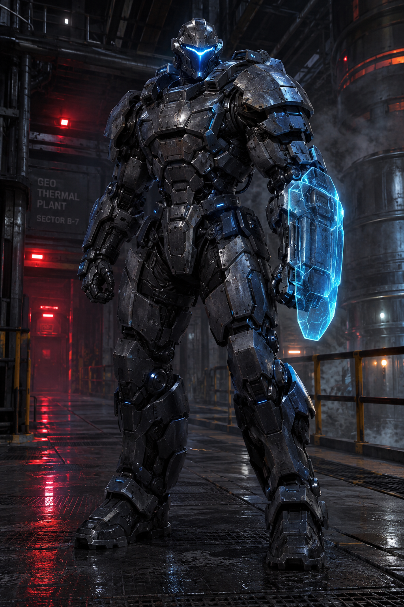
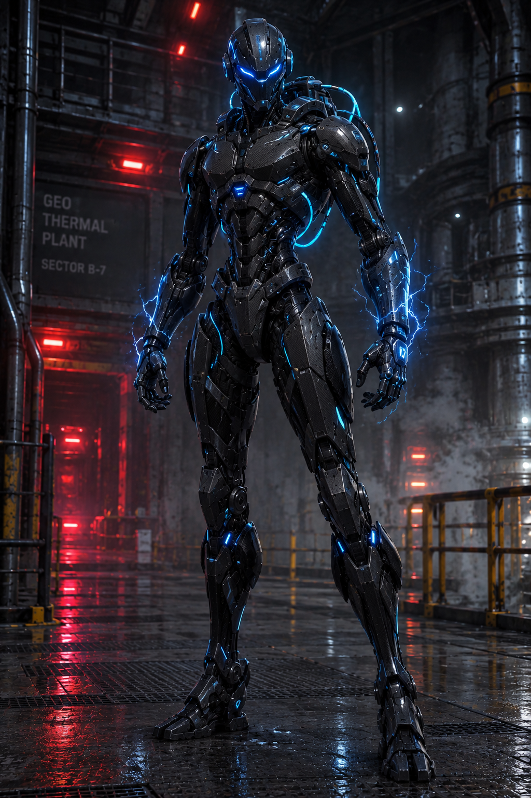
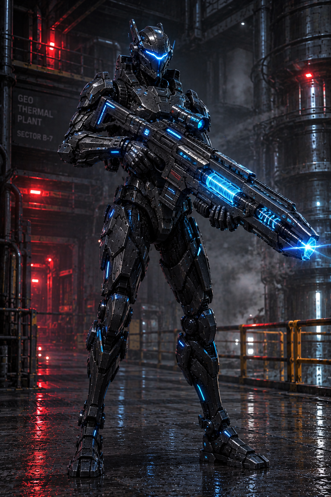

# Unidade Isolada: Setor Alfa

**Aluno:** Hadrianus da Silva Lima 
**Matrícula:** 20260012029 
**Disciplina:** DCT1106 - Programação (BSI / UFRN - 2026.2)  
**Padrão da Linguagem:** C99 (`-std=c99`)

---

## 📖 História do Jogo

Em 2142, o **Setor Alfa** — maior usina geotérmica e centro de processamento automatizado da megacidade de Neo-Veridia — sofreu um ataque crítico. Uma entidade de código parasita, nomeada como **Vírus Primordial**, se infiltrou no mainframe central, assumiu o controle das máquinas de segurança e iniciou uma sobrecarga no reator principal.

Isolado fisicamente da rede interna em uma câmara blindada, você assume o controle do último androide não infectado. Guiado via rádio pela **Dra. Valéria**, da equipe de sistemas, sua missão é atravessar os três níveis da instalação, recuperar as credenciais de segurança nos terminais e derrotar o Vírus Primordial antes que o colapso do reator destrua a cidade.

---

## 🤖 Personagens Jogáveis (Classes)

Ao iniciar o sistema, o jogador escolhe uma entre três configurações de combate, cada uma com atributos, equipamento e habilidade especial diferente:

| Classe | Equipamento | Carga Máx. (HP) | Poder de Ataque | Blindagem | Vel. Processamento | Habilidade Especial |
| :--- | :--- | :---: | :---: | :---: | :---: | :--- |
| **Vanguarda** | Armadura de Titânio | 150 | 10 | 15 | 5 | **Proteção de Dano:** Aumenta a blindagem em **80%** durante o turno. |
| **Infiltrador** | Processador 100GHz | 100 | 12 | 8 | 18 | **Roubo de Carga:** Causa dano igual a `Ataque + Processamento` e recupera esse valor em bateria. |
| **Artilheiro** | Arma de Plasma | 90 | 20 | 5 | 10 | **Maior Dano:** Disparo crítico que causa `1.5x` o Poder de Ataque diretamente na carga do inimigo. |

### Galeria das Unidades
| Vanguarda | Infiltrador | Artilheiro |
| :---: | :---: | :---: |
|  |  |  |

---

## 🗺️ Fases, Missões e Inimigos

O jogo é dividido em **3 fases** com dificuldade aumentada ao decorrer da progressão. Nas Fases 2 e 3, o acesso ao chefão exige que o jogador pare antes em uma casa de terminal (`[ ? ]`) para coletar o item de missão; caso contrário, a trava de segurança manda o android de volta ao início do setor.

### Galeria dos Chefes de Setor
| Guardião do Perímetro (Fase 1) | Amálgama Cibernético (Fase 2) | Vírus Primordial (Fase 3) |
| :---: | :---: | :---: |
|  |  |  |

### Fase 1 — Perímetro Externo
* **Missão:** Atravessar o pátio externo e derrotar o Guardião do Perímetro para liberar o elevador de carga (trava mecânica, não exige nenhum item especial).
* **Inimigos Comuns:**
  * *Drone Defeituoso:* Carga `30` | Ataque `12` | Blindagem `4` | Recompensa `10 XP`
  * *Guarda Cibernético:* Carga `40` | Ataque `16` | Blindagem `5` | Recompensa `20 XP`
  * *Sentinela de Elite:* Carga `45` | Ataque `18` | Blindagem `6` | Recompensa `25 XP`
* **Chefão:** *Guardião do Perímetro* — Carga `80` | Ataque `14` | Blindagem `8` | Recompensa `50 XP`

### Fase 2 — Setor de Manutenção e Processamento
* **Missão:** Localizar o **Cartão de Acesso** em uma casa `[ ? ]` e derrotar o Amálgama Cibernético.
* **Inimigos Comuns:**
  * *Soldador Corrompido:* Carga `60` | Ataque `14` | Blindagem `5` | Recompensa `20 XP`
  * *Operário Cibernético:* Carga `80` | Ataque `19` | Blindagem `7` | Recompensa `40 XP`
  * *Vigia do Subsolo:* Carga `90` | Ataque `22` | Blindagem `9` | Recompensa `50 XP`
* **Chefão:** *Amálgama Cibernético* — Carga `140` | Ataque `22` | Blindagem `12` | Recompensa `80 XP`

### Fase 3 — O Núcleo do Sistema
* **Missão:** Baixar o **Código de Sobrescrita** em uma casa `[ ? ]` e eliminar o Vírus Primordial.
* **Inimigos Comuns:**
  * *Anomalia Quântica:* Carga `90` | Ataque `16` | Blindagem `6` | Recompensa `30 XP`
  * *Inquisidor do Sistema:* Carga `120` | Ataque `22` | Blindagem `9` | Recompensa `60 XP`
  * *Avatar da Corrupção:* Carga `135` | Ataque `25` | Blindagem `12` | Recompensa `75 XP`
* **Chefão Final:** *Vírus Primordial* — Carga `250` | Ataque `28` | Blindagem `18` | Recompensa `150 XP`

---

## ⚙️ Dinâmica e Regras do Jogo

### Tabuleiro e Casas
O mapa é representado por um vetor linear de **20 casas** (índices `0` a `19`). Cada turno, o jogador lança um dado **d6** (`1` a `6`) para avançar:
* `[ P ]` — Posição atual do jogador.
* `[   ]` — **Casa Vazia:** Trecho seguro sem eventos perigosos.
* `[ ! ]` — **Casa de Combate:** Inicia uma batalha por turnos contra um inimigo aleatório da fase.
* `[ + ]` — **Ponto de Recarga:** Recupera `+20` pontos de carga (se limitando à carga máxima).
* `[ * ]` — **Armadilha de Vírus:** Pulso elétrico que infere `-15` pontos de carga.
* `[ $ ]` — **Compartimento Técnico:** Dá aleatoriamente `+10` de Carga Máxima (com recarga total), `+10` de Ataque ou `+15` de Blindagem.
* `[ ? ]` — **Terminal de Objetivo:** Libera o *Cartão de Acesso* (Fase 2) ou o *Código de Sobrescrita* (Fase 3).
* `[ M ]` — **Chefão do Setor:** Guarda a saída da fase na última casa do tabuleiro.

### Combate por Turnos e Fórmulas
1. **Atacar:** Rola um dado **d20** (`1` a `20`).
   $$\text{Dano ao Inimigo} = \max(1, (\text{d20} + \text{Poder de Ataque}) - \text{Blindagem do Inimigo})$$
2. **Defender:** Aumenta a blindagem efetiva em **20%** (`Blindagem * 1.20`) contra o contra-ataque do inimigo.
3. **Habilidade Especial:** Ativa o poder exclusivo da classe. Possui tempo de recarga de **5 turnos** em combates comuns e **3 turnos** contra chefes.
4. **Fugir:** Disponível apenas contra inimigos comuns. Rola um **d6**; se o resultado for maior que `3` (50% de chance), o jogador recua sem receber XP.
5. **Turno do Inimigo:** Se sobreviver, o inimigo rola um **d20** e ataca (garantindo perfuração mínima de 25% do seu ataque base):
   $$\text{Dano ao Jogador} = \max(\text{Ataque do Inimigo} / 4, (\text{d20} + \text{Ataque do Inimigo}) - \text{Defesa Efetiva})$$

### Evolução e Condições de Fim de Jogo
* **Bônus Pós-Combate:** Ao derrotar qualquer inimigo, além do XP, o sistema analisa os dados da batalha e concede aleatoriamente um aprimoramento permanente (`+1 Poder de Ataque`, `+1 Blindagem`, `+1 Vel. de Processamento` ou `+5 Carga Máxima`).
* **Subida de Nível:** A cada **40 XP** acumulados, a unidade evolui automaticamente, restaura 100% da bateria e ganha bônus fixos conforme a classe (Vanguarda: `+20 Carga Máx, +3 Blindagem, +1 Ataque`; Infiltrador: `+10 Carga Máx, +4 Processamento, +2 Ataque`; Artilheiro: `+5 Carga Máx, +5 Ataque, +1 Blindagem`).
* **Vitória:** Concluir a missão da Fase 3 derrotando o Vírus Primordial.
* **Derrota (Game Over):** A carga atual da bateria chegar a `0` ou menos em qualquer momento.

---

## 🛠️ Estrutura do Código

O projeto foi modularizado em arquivos de cabeçalho (`include/`) e implementação (`src/`):

```text
├── include/
│   ├── combate.h      # Protótipos de dados, dano e combate por turnos
│   ├── estruturas.h   # Definições de enums (ClasseRobo, Tipohabilidade, Tipocasa, Tipoacao) e structs (Personagem, Monstro)
│   ├── mapa.h         # Protótipos do tabuleiro, eventos, narrativa e fluxo de fases
│   ├── personagem.h   # Protótipos de criação, status, bônus e progressão de XP/Carga
│   └── terminal.h     # Protótipos de controle de tela, limpeza de buffer, pausa e leitura segura
├── src/
│   ├── combate.c      # Lógica de combates comuns, chefes e aplicação de dano por ponteiro
│   ├── main.c         # Fluxo principal do ciclo de fases
│   ├── mapa.c         # Inicialização/exibição do vetor mapa, eventos e diálogos
│   ├── personagem.c   # Inicialização de atributos, bônus aleatório e evolução por ponteiros
│   └── terminal.c     # Limpeza de buffer e utilitários de terminal
├── images/
│   ├── personagens/
│   │   ├── VANGUARDA.png
│   │   ├── INFILTRADOR.png
│   │   └── ARTILHEIRO.png
│   └── monstros/
│       ├── GUARDIAO_DO_PERIMETRO.png
│       ├── AMALGAMA_CIBERNETICO.png
│       └── VIRUS_PRIMORDIAL.png       # Artes conceituais dos personagens e monstros
├── video/
│   └── link_video.md  # Link para o vídeo de demonstração no YouTube/Drive
├── Makefile           # Automação de compilação (-std=c99)
└── README.md          # Documentação do projeto
```

### Principais Estruturas e Ponteiros
* **`Personagem` e `Monstro` (`estruturas.h`):** Modelam as entidades do jogo utilizando enumerações (`ClasseRobo`, `Tipohabilidade`, `Tipocasa`, `Tipoacao`) para eliminar números mágicos e facilitar na leitura do código.
* **Manipulação por Referência:** Todas as modificações de estado — como dano em batalha (`infringirDano`, `receberDano`), bônus aleatório (`aplicarBonusAleatorio`), evolução (`verificarXpMax`), recargas/armadilhas (`executarEvento`) e deslocamento no mapa (`moverJogador`) — são realizadas via ponteiros (`Personagem *`, `Monstro *`, `int *`), alterando os dados diretamente na memória.

---

## 🚀 Como Compilar e Executar

### Pré-requisitos
* Compilador **GCC** instalado (`build-essential` no Linux ou MinGW no Windows).
* Utilitário **Make** (opcional).

### Linux / macOS
1. Clone o repositório e acesse a pasta do projeto:
   ```bash
   git clone https://github.com/hadrianuslima06/rpg-c-tabuleiro.git
   cd rpg-c-tabuleiro
   ```
2. Compile utilizando o `Makefile`:
   ```bash
   make
   ```
   *Ou compile manualmente com `gcc`:*
   ```bash
   gcc -std=c99 -Wall -Wextra -Iinclude src/*.c -o jogo_rpg
   ```
3. Execute o jogo:
   ```bash
   ./jogo_rpg
   ```

### Windows (Prompt de Comando / PowerShell com MinGW)
1. Compile os arquivos-fonte:
   ```cmd
   gcc -std=c99 -Wall -Wextra -Iinclude src\*.c -o jogo_rpg.exe
   ```
2. Execute:
   ```cmd
   jogo_rpg.exe
   ```

---

### 🎨 Geração das Artes Conceituais (IA)

As ilustrações das classes jogáveis (`images/personagens/`) e dos chefes de setor (`images/monstros/`) foram geradas por inteligência artificial com base nas especificações de equipamento, habilidades e cenários do Setor Alfa.

* **Ferramenta utilizada:** ChatGPT

<details>
<summary><strong>Clique para visualizar os prompts utilizados</strong></summary>

#### Personagens (`images/personagens/`)
* **Vanguarda (`VANGUARDA.png`):**
  > *"Gere uma imagem de corpo inteiro de um androide de combate pesado cuja sua classe é Vanguarda, equipado com placas espessas de armadura de titânio em camadas, ombreiras reforçadas e uma barreira de escudo de energia azul ciano translúcida a frente do antebraço. Capacete futurista com visor óptico azul, em pé dentro de um corredor industrial escuro de uma usina geotérmica com algumas estruturas metálicas, um pouco de fumaça e luzes de emergência vermelhas ao fundo. Um design sci-fi realista, articulações mecânicas detalhadas, textura de metal um pouco desgastado, imagem conceitual de personagem de jogo, alta definição."*

* **Infiltrador (`INFILTRADOR.png`):**
  > *"Gere uma imagem de corpo inteiro de um androide ágil e leve cuja sua classe é Infiltrador, com chassi mais fino de fibra de carbono preto fosco e liga metálica escura, formato aerodinâmico e conduítes neurais brilhantes em azul ciano conectados a uma unidade de processamento de alta frequência na parte superior das costas. Cabeça tática com sensores ópticos azuis brilhantes, arcos elétricos de drenagem de energia nas manoplas, em pé dentro de um corredor industrial escuro de uma usina geotérmica com algumas estruturas metálicas, um pouco de fumaça e luzes de emergência vermelhas ao fundo. Um design sci-fi realista, articulações mecânicas detalhadas, textura de metal um pouco desgastado, imagem conceitual de personagem de jogo, alta definição."*

* **Artilheiro (`ARTILHEIRO.png`):**
  > *"Gere uma imagem de corpo inteiro de um androide de combate ofensivo médio leve cuja sua classe é Artilheiro, com chassi tático aerodinâmico e blindagem leve menor para mobilidade, usando um capacete futurista com visor óptico azul brilhante e uma mira de precisão. Postando um rifle de plasma pesado e detalhado com bobinas de energia azul ciano forte, saídas de calor e partículas de plasma carregadas prontas para disparar, em pé dentro de um corredor industrial escuro de uma usina geotérmica com algumas estruturas metálicas, um pouco de fumaça e luzes de emergência vermelhas ao fundo. Um design sci-fi realista, articulações mecânicas detalhadas, textura de metal um pouco desgastado, imagem conceitual de personagem de jogo, alta definição."*

#### Chefes de Setor (`images/monstros/`)
* **Guardião do Perímetro (`GUARDIAO_DO_PERIMETRO.png`):**
  > *"Gere uma imagem de corpo inteiro de um robô chefe de defesa de segurança corrompido e grande, seu nome é Guardião do Perímetro, com armadura frontal pesada de blindagem rígida, vários sensores ópticos vermelho (carmesim) brilhantes e miras laser vermelhas, acoplado a estabilizadores hidráulicos pesados. Em pé em um pátio industrial escuro e chuvoso de uma usina geotérmica com estruturas metálicas molhadas e luzes de emergência vermelhas ao fundo. Uma estética de máquina corrompida por vírus, design sci-fi realista, aço escuro desgastado, imagem conceitual de chefe de jogo, alta definição."*

* **Amálgama Cibernético (`AMALGAMA_CIBERNETICO.png`):**
  > *"Gere uma imagem de corpo inteiro de uma máquina industrial monstruosa fundida, seu nome é Amálgama Cibernético, uma criatura mecânica assimétrica imponente feita de guindastes de carga pesados, braços de solda industriais, garras hidráulicas e vigas de aço retorcidas fundidas por um vírus de computador. Circuitos corrompidos brilhando em vermelho (carmesim), cabos de alta tensão soltando faíscas e maçaricos de plasma acesos. Em pé em um setor subterrâneo quente e enfumaçado de manutenção industrial bloqueando a comporta de um reator, faíscas laranjas e luzes de alarme vermelhas ao fundo. Design sci-fi industrial realista, texturas de metal manchado de óleo, iluminação dramática, imagem conceitual de chefe de jogo, alta definição."*

* **Vírus Primordial (`VIRUS_PRIRMODIAL.png`):**
  > *"Gere uma imagem de corpo inteiro de um avatar físico de núcleo cibernético chefe final, seu nome é Vírus Primordial, uma entidade imponente levitando conectada ao mainframe central, ao redo tem estruturas de servidores escuros, cabos de fibra óptica grossos e lâminas metálicas flutuantes. Um núcleo de vírus holográfico em vermelho (carmesim) e violeta no centro do peito, projetando fluxos de código digital vermelho com falhas e eletricidade estática roxa. Dentro de uma câmara do núcleo de um reator geotérmico futurista com monitores piscando em vermelho e torres de servidores ao fundo. Design sci-fi futurista, iluminação de alto contraste, imagem conceitual de chefe final de jogo, alta definição."*

</details>

## 🎥 Vídeo de Demonstração

* **Link do Gameplay:** [colocarei quando tiver pronto]